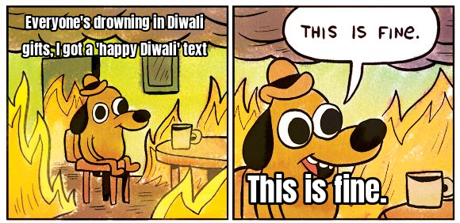
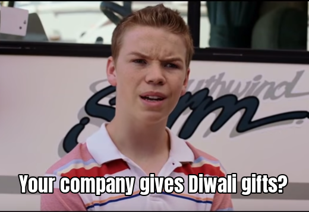
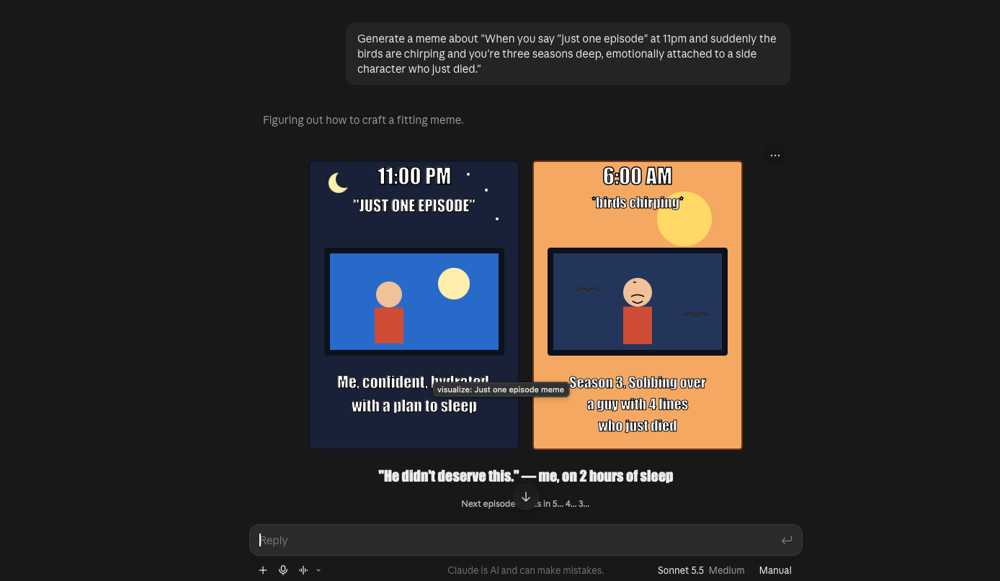
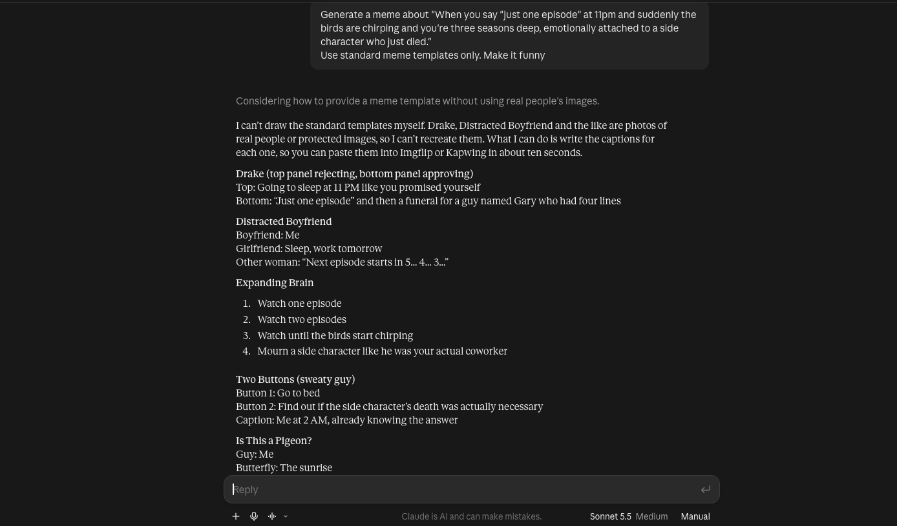
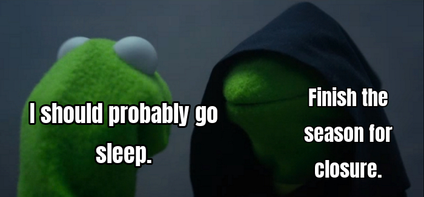

_Diwali meme numero uno_

## A little bit on the why

One of the things that Gen-Z have become infamous for are memes and Im no different. I have always enjoyed looking at memes and reels after a long day of work. And over the past few months, I have seen so many wonderful and interesting applications being built. So I thought "Why dont I try and build an AI meme making application. I have access to a bunch of SOTA LLMs. How hard could it possibly be?". Turns out, quite hard. In simple words, the goal of this application was to spit out high quality memes based on the user's input scenario. The catch is, I didnt want to hand over the entire meme generation job to the AI - you couldnt just make an image generation API call to Claude or OpenAI cause the memes felt off and had that unmissable AI generated feel to them. The AI had to use existing, well-known meme templates for making these memes because part of the fun is in the actual template itself.

_Claude generating a bleh meme_

_Claude refusing to generate actual memes. It only gives captions, not real memes_

## A lot about the how

### The AI part

The AI side of things closely parallels how a human would normally make memes. There is a Strategist whose job is to pick the templates that fit the user's scenario, the Copywriters then fill in the content for each of the selected templates. Each generated meme is scored by the Judge and if a generated meme scores poorly, it goes back to the Copywriter with some feedback and gets a retry attempt. But before the Strategist can even pick a suitable template, we need an ingestion pipeline. The ingestion pipeline determines the nature of the meme, what it would best fit for, where the text zones should go, gives the meme template a suitable name etc. Since we use top of the line LLMs for the ingestion, they would have mostly seen the popular meme templates so the ingestion process becomes a tad bit easier. Once a raw meme template has been processed by the AI, we make another LLM act as a Judge and it evaluates the results. It then proceeds to score the template and if the score is high enough, it gets added to the list of templates in our application. If the new template scores poorly, it gets sent to a human for further review. The human can then decide to add more text zones, change positions of text boxes, change the description of the template etc or if it is beyond repair, they can also reject the template. This is one of my favourite things about this project. A common issue that we hit during the ingestion was with the text box placeholders. They were either placed incorrectly(they got cut off etc) or there were just too few text boxes. With the "human in the loop" design, if there is a minor intervention by a human user during the larger AI workflow, the quality of the output jumped dramatically. Some templates performed poorly during the ingestion process and were correctly flagged by the AI for further human review. After spending some time doing a few manual corrections, the templates were salvageable and all was not lost(goes to show that humans still have an edge over AI :))

### The backend and DB

The backend runs on FastAPI and uses Postgres for the DB with sqlalchemy driving the DB interactions. For tracking DB schema changes, I used Alembic. This might seem a little overkill for this solo project(which I think it definitely might be), the idea behind using Alembic was to learn how to use DB migration tools - at work we use Liquibase for tracking DB schema changes for the entire organization and the rails for this were already set up before I joined. I really wanted to understand how to set up something like that from scratch and this project seemed like a good opportunity to learn that.

With so many LLM calls happening, it is paramount that they dont bottleneck the entire application under load. I used ARQ for this. And tbch, I had never used ARQ before so this was again something new which I picked up during this project. To give users real time updates, I used Redis PubSub and SSE.

And as of writing this, there is no paid plan involved. A user can connect their Google Account via OAuth and get 10 free generation credits. With such a free tier, it felt important to be a bit aggressive with the credit management process because any gaps here could easily drain the AI API credits and derail the budget which I had planned for this project. Checking the balance credits and recording a spend are two steps and if a user double-clicks, both requests can see '9 used' and they both succeed. Locking the user's row makes that user's requests take turns, so exactly one gets the 10th credit. We use pessimistic row-level locking to prevent incorrect consumption of credits. My first version didnt have this locking mechanism and then Claude pointed it out to me(thanks Claude! :))

### The frontend

The frontend uses React and to adjust the text zones of each template, I used the Konva library. UI is an area where Claude helped immensely. I was able to use Claude Design where I described the project and the UI requirements and Claude made a few sample renderings of the UI. After going back and forth with the corrections, it was simply a matter of connecting the GitHub repo and have Claude make the necessary code changes to get the UI in top notch shape.

### Deployment

Not sure if you noticed but there is a common theme across the various portions of this project - I used this as an opportunity to learn and work with a new library or tech stack. And the deployment is no different. My go to for deployments is usually Dockerizing the whole project and deploying it on a VPS(Hetzner ftw). But something that was gnawing at me was the fact that I learnt about the AWS CDK a while back but never got the opportunity to get my hands dirty with it(the very idea of having code represent things that arent code-like infrastructure in this case-was intriguing). And as usual, this project became my guinea pig. This is again an area where Claude helped out immensely. If you have ever deployed something on AWS or Google Cloud, you are probably aware of that sinking feeling when you get the bill the next month and realise you left a bunch of things running(and lo and behold there go your plans of buying a new PS5). To prevent such mishaps, I used Claude as a guide along every step of the way and vetted my approach. It also helped immensely with syntax issues and catching bugs in the code that I failed to spot. It also put together a small bash script which checks that no AWS resources are still running(even things that the CDK didnt know about).

The initial plan with the CDK was to use something like ECS but with the load balancers and RDS, the cost estimate went up to 90 USD per month. Lightsail was the next best choice and comes in at 13 USD a month(a lot more expensive compared to Hetzner). This was quite fun and interesting but by no means do I consider myself an expert on the AWS CDK. With a few more projects, I think this should be in the bag.

### Security Audit

With AI being used to orchestrate so many cyber attacks and the general consensus to defend against this is to use AI ourselves to analyse and seal the gaps, I did the same thing with this project. I hooked up the Cloudflare security audit skill with Claude Code running Opus 5.5 and gave it free reign to find and report security flaws.

While the core application was okay, the overall setup had its fair share of flaws. After going through the report and fixing it, I came out having learnt a lot of "best practices". The most obvious issue which I missed was not binding dev ports to 127.0.0.1. Without this, other users on the same network could technically snoop in on the website I was running in dev mode. But by anchoring it to loopback IP, this can be fixed. Another one of my favourite issues which we discovered was setting limits for max SSE connections, releasing resources when not in use etc.

In hindsight, all these fixes feel basic but the fact that they were missed during development and were only caught by AI goes to show just how important this security audit was. Without fixing all these tiny gaps, a bad actor couldve easily wrecked the application.
